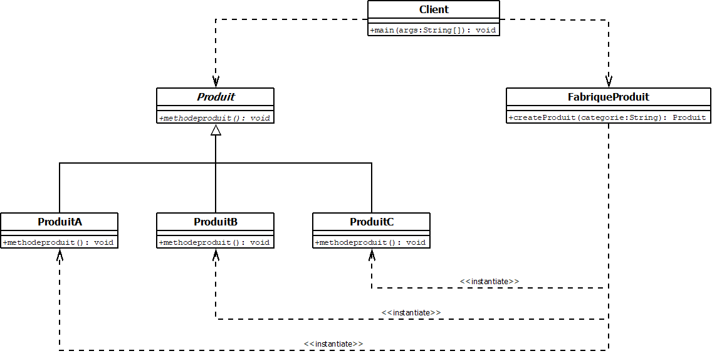
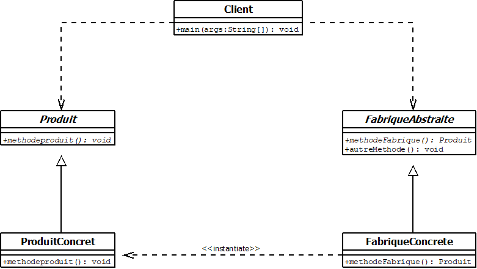
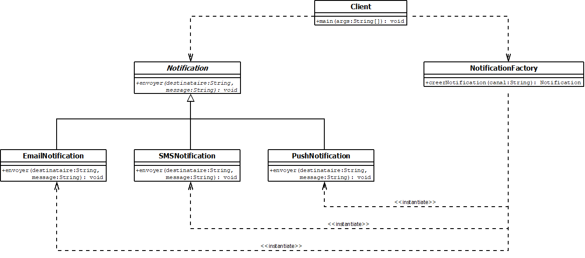
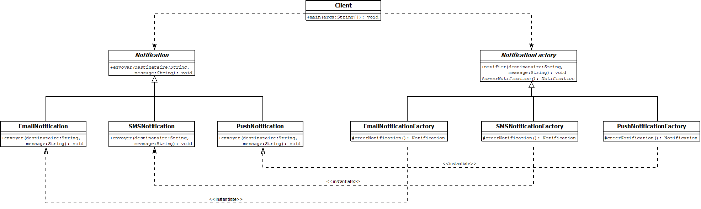

# Patron de construction : Factory (Fabrique)

Devoir n° 1 – INF4067 / INF461 – GOYE AWOUMA CHAINE LEONEL.

Le patron Factory crée un objet dont le type n'est connu qu'à l'exécution, sans que le client
manipule les classes concrètes. Il est implémenté ici sous ses deux formes vues en cours :

1. **Factory Method** : une fabrique avec une méthode de création paramétrée, `createProduit(type)`.
2. **Fabrique abstraite** : une classe de fabrique abstraite, dont chaque sous-classe crée un produit.

## Structure

```
cours/      exemple du cours (Produit, ProduitA/B/C)      src/ et uml/
variante/   exemple modifié (notifications Email, SMS, Push)  src/ et uml/
documentation/analyse.md
```

Dans chaque dossier `src`, le paquet `factorymethod` contient la forme 1 et `factoryabstraite` la forme 2.

## Exécution

```bash
javac -d out/cours $(find cours/src -name '*.java')
java -cp out/cours factorymethod.Client
java -cp out/cours factoryabstraite.Client

javac -d out/variante $(find variante/src -name '*.java')
java -cp out/variante factorymethod.Client SMS PUSH
java -cp out/variante factoryabstraite.Client
```

## Diagrammes

| | Factory Method | Fabrique abstraite |
|---|---|---|
| Cours |  |  |
| Variante |  |  |
